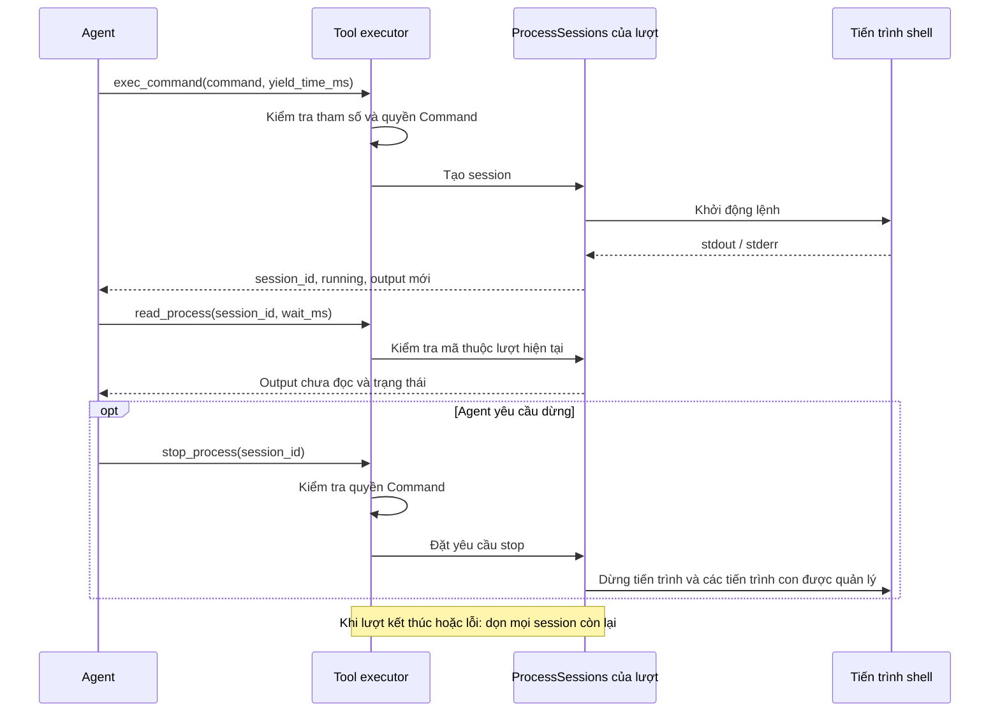

# Process session trong Atlas

Trạng thái: **tham chiếu hành vi đã triển khai**, đối chiếu mã nguồn ngày 2026-11-09.
Tài liệu này mô tả session trong một lượt agent. Đề xuất giữ tài nguyên theo chat
qua nhiều lượt đang nằm trong draft local và chưa được triển khai.

## Session dùng để làm gì?

Một process session là mã theo dõi một lệnh shell đang chạy. Agent dùng mã này để
đọc output mới hoặc yêu cầu dừng lệnh. Mã là UUID opaque, không phải PID hệ điều
hành và không phải conversation ID.

Lượt agent bắt đầu khi xử lý một tin nhắn, bao gồm nhiều lần gọi model/tool, và
kết thúc khi có câu trả lời cuối hoặc lỗi. Runtime của lượt đó sở hữu manager;
manager giữ tiến trình, buffer output và trạng thái. Session sống qua các lần gọi
tool trong lượt, nhưng không sống qua tin nhắn tiếp theo.



## Ba tool liên quan

| Tool | Tham số | Kết quả và quyền |
| --- | --- | --- |
| `exec_command` | `command`; tùy chọn `yield_time_ms`, `timeout_ms` | Khởi động lệnh. Quyền Command. |
| `read_process` | `session_id`; tùy chọn `wait_ms` | Đọc phần stdout/stderr chưa tiêu thụ và trạng thái. Quyền ReadOnly. |
| `stop_process` | `session_id` | Yêu cầu dừng, chờ tối đa khoảng 2 giây cho kết quả cleanup. Quyền Command. |

Ask và Workspace cần xác nhận cho thao tác Command. Full access bỏ qua xác nhận
của Atlas, không nâng quyền hệ điều hành. Mọi lần gọi vẫn đi qua executor; biết
session ID không cấp quyền và không cho phép truy cập session của runtime khác.

Không truyền `yield_time_ms` thì lệnh chạy đồng bộ như trước. Khi có tham số này,
Atlas chờ tối đa thời gian đã chọn; lệnh chưa xong trả `running: true` và
`session_id`. Nếu đã xong thì trả `running: false` cùng kết quả. Chế độ session
vẫn trả ID ở kết quả hoàn tất, nhưng bản ghi có thể bị loại theo giới hạn lưu giữ.

## Ví dụ agent đọc log

Các JSON dưới đây là **arguments của tool**, không phải toàn bộ envelope giao thức.
Ví dụ lệnh dùng cú pháp shell Unix.

1. Agent gọi `exec_command`:

```json
{"command":"cargo test","yield_time_ms":1000,"timeout_ms":120000}
```

2. Nếu lệnh chưa hoàn tất, kết quả có dạng:

```json
{"session_id":"<opaque-id>","running":true,"stdout":"...","stderr":""}
```

3. Agent dùng đúng mã trả về, gọi `read_process`:

```json
{"session_id":"<opaque-id>","wait_ms":1000}
```

4. Khi `running` là `false`, kiểm tra `exit_code`, `timed_out`, `stopped` và `error`
trước khi báo kết quả. Nếu cần dừng, gọi `stop_process` với cùng `session_id`.

Đọc log không chạy lại lệnh và không trả lại phần output đã đọc. Một lần poll có
thể chưa có output mới mà tiến trình vẫn chạy. Agent cần ghép các chunk nếu muốn
xem kết quả đầy đủ, không chỉ giữ lần poll cuối.

## Trạng thái và kết quả

| Trường | Ý nghĩa |
| --- | --- |
| `session_id` | Mã thuộc manager của lượt hiện tại. |
| `running` | Worker chưa ghi nhận hoàn tất/cleanup. |
| `stdout`, `stderr` | Output mới được tiêu thụ bởi lần đọc này. |
| `stdout_truncated`, `stderr_truncated` | Buffer chưa đọc tương ứng đã mất dữ liệu do đầy; không được coi log là đầy đủ. |
| `exit_code` | Mã thoát nếu có; `null` không chứng minh thành công. |
| `timed_out` | Lệnh đã bị dừng vì vượt timeout. |
| `stop_requested` | Đã gửi yêu cầu dừng. |
| `stopped` | Worker xác nhận đường xử lý dừng; khác với chỉ mới yêu cầu stop. |
| `error` | Lỗi khởi chạy/worker nếu có. |

`stop_process` có thể trả `running: true` nếu cleanup chưa hoàn tất. Khi đó dùng
`read_process` để kiểm tra tiếp; không báo đã dừng chỉ dựa vào `stop_requested`.
Dừng hoặc timeout không hoàn tác những tác động lệnh đã thực hiện trước đó.

## Giới hạn và cleanup

| Hạng mục | Hành vi hiện tại |
| --- | --- |
| Session đang chạy | Tối đa 8 mỗi manager; vượt giới hạn bị từ chối trước khi spawn. |
| Bản ghi giữ lại | Tối đa 32; loại bản ghi hoàn tất cũ để nhường chỗ. |
| Output chưa đọc | Tối đa 64 KiB mỗi stream; giữ phần gần nhất và báo truncation khi overflow. |
| `yield_time_ms` | 0–10000 ms. |
| `wait_ms` | 0–10000 ms, mặc định 1000 ms. |
| `timeout_ms` | 1–600000 ms; mặc định 30 giây đồng bộ, 10 phút cho session. |
| UTF-8 | Giữ đuôi ký tự chưa đủ byte cho lần đọc tiếp; byte không hợp lệ được biểu diễn thay thế. |
| Khi kết thúc lượt | Đặt stop và join worker, dọn cả khi final answer hoặc lỗi. |

Unix quản lý process group; với session, các thành viên group còn lại bị dừng
trước khi reap shell leader để tránh nhầm PID tái sử dụng. Windows dùng process
khởi động suspended và Job Object kill-on-close. Đây là cleanup cho các tiến trình
con còn trong phạm vi quản lý, không phải sandbox ngăn shell tự thoát phạm vi đó.
Cleanup theo vòng đời bình thường không phải bảo đảm trước mọi kiểu crash, mất
điện hoặc cưỡng bức kết thúc app từ bên ngoài.

Chạy chương trình ở foreground khi dùng session. Nếu shell kết thúc sau khi tự
đẩy chương trình xuống background (`&`), các tiến trình con được quản lý sẽ bị dọn.
Chưa có stdin/PTY, terminal tương tác, log có thể replay trên UI, process background
qua nhiều lượt chat, hoặc cơ chế khôi phục session sau restart. Activity lưu thành
công có thể chứa chi tiết đã sanitize/bounded; nó không phải session còn sống hay
kênh đọc lại toàn bộ stdout/stderr.

## Vị trí mã nguồn và kiểm chứng

- [Manager và các tool process](../../src/tools/process_sessions.rs).
- [Executor Unix](../../src/tools/exec_command.rs) và [executor Windows](../../src/tools/exec_command_windows.rs).
- [Tool registry và request scope](../../src/tools/mod.rs).
- [Runtime điều phối lượt](../../src/runtime.rs).
- [Desktop tạo runtime mỗi lượt](../../desktop/src-tauri/src/commands.rs).
- [Test process trên Unix](../../tests/process_session_behavior.rs),
  [Windows](../../tests/process_session_windows_behavior.rs) và
  [test vòng gọi tool của runtime](../../tests/tool_call_behavior.rs).

Linux đã có kiểm chứng test/build. Windows native compile đã qua; test executable
cập nhật từng bị Application Control chặn, nên không suy ra native execution đã
được xác minh đầy đủ. Chưa kiểm chứng native macOS.
