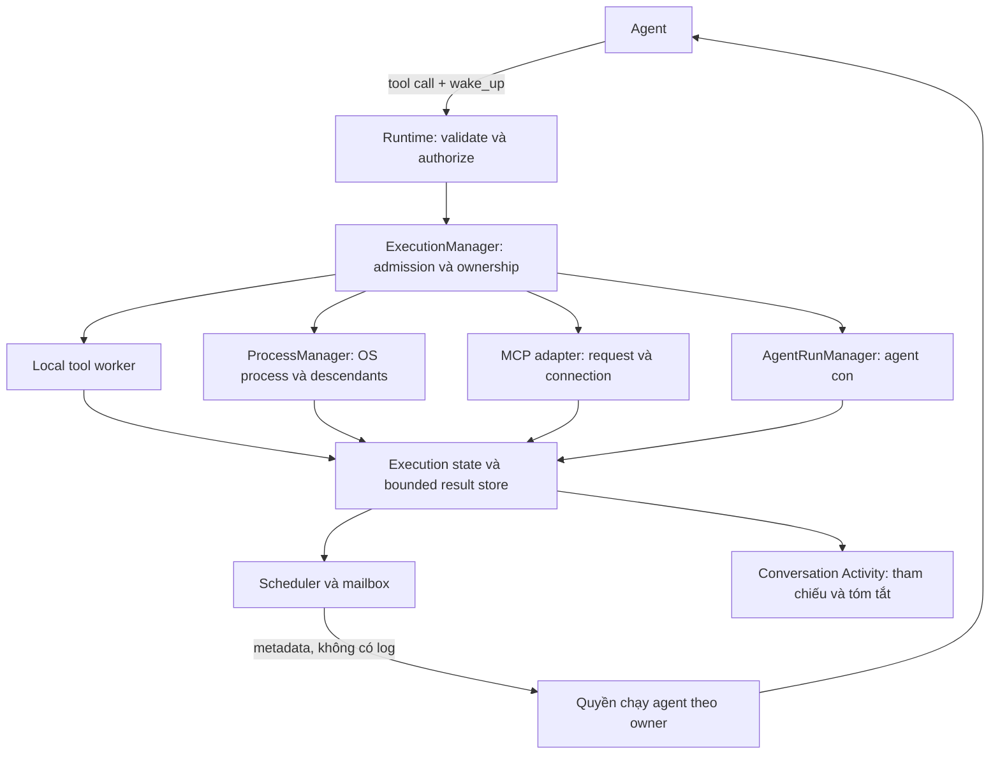

# Tool execution control và Wakeup hard/lazy

Trạng thái: **thiết kế được user chốt ngày 2026-11-13; chưa triển khai**.
User xác nhận quy tắc hard/lazy và yêu cầu ghi vào docs kiến trúc. Tài liệu này
thay thế hướng thiết kế `execution.mode: job/task` của [Wakeup](wakeup.md).
Nó không khẳng định code hiện tại đã đổi giao thức hoặc đã lưu bền execution.

## 1. Quyết định chính

Mọi lần gọi tool đều là một execution có chủ sở hữu và được quản lý qua một đầu
mối trong backend. Không có nhánh tool đồng bộ chạy ngoài việc ghi nhận execution.
Tool nhanh có thể trả kết quả ngay, nhưng vẫn phải có record và kết quả.

Bỏ lựa chọn `job/task` ở cấp execution. Agent chỉ chọn **nhịp wake_up**:

| Chế độ | Khi còn chạy | Khi kết thúc, lỗi hoặc cần tương tác |
| --- | --- | --- |
| `hard` | Agent chọn khoảng kiểm tra, từ 0.1 giây đến dưới 30 giây | Xếp thông báo ngay |
| `lazy` | Nhắc lại mỗi 10 phút, tính từ lần lập lịch gần nhất | Xếp thông báo ngay, không đợi 10 phút |

Hard/lazy không thay đổi quyền tool, timeout, thứ tự phụ thuộc hoặc vòng đời của
công việc. Lazy không phải quyền bỏ qua kết quả hoặc chạy nền sau câu trả lời cuối.
Agent chọn nhịp theo tính quan trọng, mức cần can thiệp và thời gian dự kiến; có
thể đổi nhịp trong lúc chạy mà không gọi lại tool. Rủi ro vẫn do backend xác định
và áp dụng approval hiện hành; agent không tự hạ quyền bằng cách chọn lazy.

Các giá trị mặc định phải được khai báo trong cấu hình runtime và hướng dẫn dùng
được render từ cùng nguồn. Nhịp mặc định đề xuất cho tool không khai báo wake_up
là hard 2 giây; con số mặc định này là quyết định triển khai, không phải hành vi
đã có. Chu kỳ lazy của thiết kế đã chốt là 600 giây.

## 2. Một đầu mối quản lý, nhiều loại executor

ExecutionManager là đầu mối quản lý logic, phát triển từ ToolExecutionManager hiện
có. Process Control dùng cùng danh sách/trạng thái/điều khiển cho mọi execution.
ProcessManager hiện có trở thành bộ phận chuyên quản lý OS process bên dưới;
không tạo một OS process cho mỗi lần đọc file hoặc gọi MCP.



Manager giữ execution ID, native owner, request ID, tên tool, trạng thái, thời
điểm, revision, wake_up policy, tham chiếu kết quả, trạng thái bàn giao thông báo
và yêu cầu hủy. Resource handle thuộc adapter; scheduler không trực tiếp chạy
shell, gọi provider hoặc kiểm tra quyền thay runtime.

Giữ `execution_id` là ID điều khiển chung. Các `session_id` của OS process và
`run_id` của agent con được ánh xạ nội bộ, không được dùng thay lẫn nhau. Native
scope là authority; model không được chọn chat owner bằng arguments.

## 3. Giao thức đích

`wake_up` là trường top-level của tool_call, tách khỏi args:

```json
{
  "type": "tool_call",
  "tool": "exec_command",
  "wake_up": {"mode": "hard", "interval_seconds": 5},
  "args": {"command": "cargo test"}
}
```

```json
{
  "type": "tool_call",
  "tool": "mcp_call_tool",
  "wake_up": {"mode": "lazy"},
  "args": {"server": "configured-server", "tool": "configured-tool", "arguments": {}}
}
```

Ví dụ MCP chỉ minh họa envelope; server/tool thực phải lấy từ catalog được phép.
Hard bắt buộc có interval hữu hạn, hợp lệ; lazy không nhận interval tùy ý.
Schema từ chối giá trị không hợp lệ, không âm thầm đổi chúng sang lazy.

Các control hiện có `list_executions`, `read_execution`, `cancel_execution` được
đưa qua cùng authority và giữ giới hạn đọc/quyền hủy. Giao thức đích bổ sung:

```json
{
  "type": "set_execution_wakeup",
  "execution_id": "opaque-id",
  "wake_up": {"mode": "hard", "interval_seconds": 2}
}
```

Đây là schema thiết kế, chưa phải API đang chạy. Cập nhật tăng schedule generation,
vô hiệu timer cũ, không dispatch lại tool và không xóa terminal notification.
`await_execution` nhường quyền chạy agent để đợi mailbox; việc đợi không thay đổi
policy của execution nếu không có cập nhật rõ ràng.

## 4. Scheduler, hàng đợi và quyền chạy agent

Một scheduler trong backend quản lý deadline của nhiều execution. Deadline heap
có generation để bỏ qua timer cũ. Khi đến hạn hard/lazy, scheduler xếp metadata
rồi lập deadline tiếp theo nếu execution vẫn chạy. Khi terminal, hủy timer định
kỳ và xếp thông báo cuối cùng. Không polling bằng model mỗi 30 giây để chờ lazy.
Nếu một hàm chờ nội bộ có giới hạn dưới 30 giây, có thể tiếp tục chờ trong backend
mà không gọi provider khi chưa có sự kiện cần giao.

Mỗi agent owner chỉ có một consumer/model call hoạt động. Lock ngắn bảo vệ trạng
thái, mailbox và quyền nhận lượt; không giữ lock trong I/O, approval hoặc model
call. Khi agent đang bận, thông báo mới ở hàng đợi đến ranh giới an toàn tiếp theo,
không chèn vào giữa response đang stream và không khởi chạy agent thứ hai.

Thông báo là metadata: execution ID, status, reason, elapsed time, revision,
unread lines và retention/truncation flags. Không kèm toàn bộ log hoặc lỗi thô.
Giữ batch tối đa 16 sự kiện và quy tắc coalesce/ack của Wakeup hiện tại:

- Gộp thông báo định kỳ theo execution ID và revision; terminal thay periodic.
- Lỗi, hoàn thành, yêu cầu tương tác ưu tiên trước periodic; FIFO trong cùng mức.
- Sự kiện đến khi batch đang xử lý vẫn pending. Ack chỉ xác nhận batch đó.
- Lỗi provider hoặc response không hợp lệ không làm mất thông báo và không replay tool.
- Terminal được giao một lần về mặt logic; bản giao chưa ack có thể được giao lại
  cùng identity để consumer xử lý idempotent, không tạo thông báo terminal mới.

Tin nhắn user đang chờ có thể đánh thức agent ở ranh giới an toàn, kèm batch
metadata công việc hiện tại. Hàng đợi user được ưu tiên trước periodic wakeup;
yêu cầu Stop rõ ràng cần đường native hủy trực tiếp, không chờ agent đọc log.
Cơ chế nhận thêm tin nhắn trong một lượt đang chạy là tích hợp tiếp theo, chưa
được coi là đã triển khai bởi tài liệu này.

## 5. Trách nhiệm kiểm tra và kết thúc lượt

Backend chặn final nếu còn execution thuộc công việc phải hoàn thành đang chạy,
đang hủy, hoặc terminal notification chưa được xử lý. Áp dụng như nhau cho hard
và lazy. Giao terminal rồi ack không tự chứng minh thành công: agent phải kiểm tra
kết quả và đọc đủ bằng chứng cần thiết trước khi kết luận; không bắt đọc hết log.

Ví dụ chạy test: agent có thể làm việc độc lập trong lúc đợi, nhưng không được báo
sửa lỗi xong chỉ vì đã khởi chạy test. Thất bại/hủy vẫn có thể dẫn đến câu trả lời
cuối trung thực về phần chưa hoàn thành, không ép agent retry cho đến thành công.
Nếu provider lỗi, hết budget, user hủy hoặc scope đóng, lưu trạng thái thực tế và
dọn công việc theo lifecycle; không gọi model vô hạn để vượt giới hạn đó.

Chỉ dịch vụ được user yêu cầu rõ ràng chạy nền mới được sống qua final. Đây là
vòng đời riêng, không suy ra từ hard/lazy. Agent phải xử lý kết quả khởi động và
báo rõ dịch vụ còn chạy. Sau final không tự gọi model; sự kiện nền được giữ để
đọc ở lượt hợp lệ tiếp theo. Cơ chế tự gọi agent xuyên lượt cần thiết kế/ủy quyền
riêng, không được bật ngầm bằng lazy.

## 6. Kết quả, conversation history và restart

Lưu kết quả execution riêng với phần chat thông thường. Conversation giữ cặp
user/final-assistant của lượt thành công; Activity giữ tham chiếu execution và bản
tóm tắt có giới hạn. Không nhét mọi lần wakeup hoặc toàn bộ stdout vào history.
Execution store giữ trạng thái/kết quả thực tế, kể cả lượt bị lỗi và không được
lưu thành cặp chat thành công. Draft dùng native owner tạm; khi promotion phải
giữ execution identity và chuyển liên kết sang conversation mà không tạo history
chỉ để cấp scope.

Thiết kế đích yêu cầu lưu bền metadata và kết quả UTF-8 có giới hạn, dùng quyền
file riêng tư, schema version và atomic publication. Persist record trước dispatch;
chỉ công bố kết quả đã lưu thành công. Nếu ghi terminal thất bại, giữ record chưa
commit và báo lỗi lưu trữ có thể phục hồi; không biến thất bại ghi đĩa thành thành
công hoặc tự chạy lại tool. Không lưu credential, approval token hoặc ảnh vào
execution artifacts; giữ các quy tắc redaction hiện hành.

Giữ giới hạn hiện có làm nền: 64 KiB output/execution, đọc tối đa 4 KiB và 1–200
dòng/lần; đọc đuôi không dịch cursor. Kết quả quá lớn phải có truncation/retention
flags. Không tự đọc mọi trang khi nhận wakeup. Dữ liệu lưu bền cũng phải có quota
và retention cấu hình được trước rollout; không được tăng vô hạn hoặc âm thầm
xóa execution đang chạy/kết quả chưa xử lý. Giới hạn bản ghi memory hiện tại
32/owner, 128/backend không thay thế chính sách quota đĩa.

Sau restart, kết quả đã commit vẫn đọc được. Execution chưa terminal được đánh
dấu interrupted với kết quả hành động có thể chưa xác định; không khôi phục handle,
không hiện Running mãi và không tự chạy lại. Interrupted là trạng thái khôi phục
mới cần triển khai, không phải trạng thái được manager hiện tại hỗ trợ.
History là bản ghi quá khứ; trạng thái live luôn lấy từ manager. Đọc artifact sau
restart không cấp quyền điều khiển execution/process ID cũ. Xóa chat áp dụng cùng
chính sách trash/cleanup cho artifact thuộc chat, và dừng resource trước khi đóng
scope; worker đến muộn không được ghi lại vào owner đã xóa.

## 7. Hủy, giới hạn và bảo toàn quyền

Hủy là yêu cầu hợp tác. OS process dùng process group/Windows Job hiện có; MCP
hoặc I/O không hỗ trợ hủy có thể còn Cancelling đến deadline. Không báo đã hủy
khi worker chưa kết thúc; hủy không hoàn tác side effect và timeout có thể có
kết quả chưa xác định. Không đổi kết quả thật thành Cancelled chỉ vì đã gửi Stop.

Giữ nguyên approval snapshot, tool grant, workspace authority, quota agent/process
và không mở thêm quyền native frontend. Mọi execution phải qua admission trước
launch; giới hạn execution và OS process là hai lớp quota khác nhau. Có ID chung
không có nghĩa một execution được tính thành nhiều OS process slot.

UI tiếp tục hiển thị inline trong hội thoại, không thêm panel Processes cố định
hoặc polling frontend. Mọi native operation vẫn đi qua atlas-api.ts. Các nhãn
Running/Cancelling/Interrupted phải phản ánh trạng thái thực tế.

## 8. Chuyển đổi từ code hiện tại và tiêu chí nghiệm thu

Code hiện tại còn `ExecutionMode::{Job, Task}`, nhánh tool đồng bộ không tạo record
chung, execution store trong RAM và prompt cũ tại config/wakeup-prompt.md.
[Wakeup hiện tại](wakeup.md) và [Process sessions](process-sessions.md) mô tả các
hành vi đang chạy, bao gồm `lifetime: job/background` của command.

Khi triển khai phải thay schema/parser, runtime final guard, scheduler, agent prompt,
worker adapters, persistence, Activity và test cùng nhau. Loại bỏ `execution.mode`
job/task khỏi catalog/prompt mới. Payload cũ cần được nhận diện và báo lỗi chuyển
đổi rõ ràng, không âm thầm map task sang lazy. Tool call thiếu wake_up nhận default
hard và vẫn được manager ghi nhận. Từ `lifetime: job` trong command cũ là chính
sách dọn theo request, không phải wake_up mode; nếu đổi tên cần migration riêng.
Các built-in conversation task và MCP Tasks là khái niệm khác, không xóa chỉ vì
trùng tên. Ví dụ/demo hiện tại vẫn kiểm thử giao thức cũ cho đến khi được cập nhật.

Kiểm chứng bắt buộc khi triển khai:

- Mọi tool, cả đồng bộ và thất bại, có record đúng owner và kết quả lưu được.
- Hard đúng interval; lazy đúng 600 giây; completion/error thức sớm trong cả hai.
- Dùng clock giả kiểm tra lazy, không sleep thật 10 phút trong test.
- Đổi nhịp bỏ timer cũ; không mất terminal; không chạy trùng tool/model.
- Lazy không vượt final guard; đọc metadata không thay xác minh bằng chứng.
- Batch/ack, provider lỗi, giới hạn context và output giữ đúng hợp đồng.
- Persistence lỗi/restart, unknown outcomes, truncation, quota, draft promotion,
  xóa chat và late publication không mất ownership hoặc tạo replay.
- Background phải có yêu cầu user; không tự gọi model sau final hoặc restart.
- Approval, command containment, cancellation và child scope cleanup không suy yếu.
