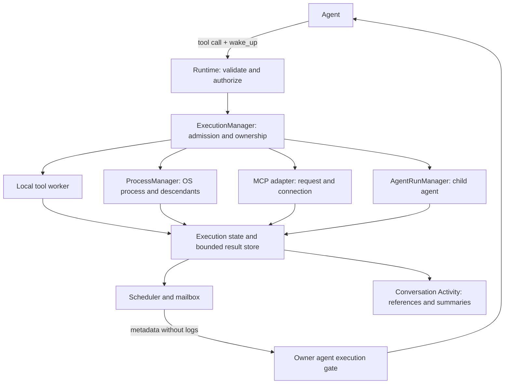

# Tool execution control and hard/lazy wakeups

Status: **design approved by the user on 2026-11-13; tool-only implementation verified**.
This document records the approved tool-execution architecture. It replaces the
former `execution.mode: job/task` protocol. [Wakeup](wakeup.md) describes the
current protocol. The hard/lazy protocol, unified execution tracking, and bounded durable records
are implemented and verified.
User-message queuing during an active turn is implemented separately; see
[Live chat input and Stop](live-chat-input.md). It is outside
this implementation.

## 1. Main decisions

Every tool invocation is an owned execution managed through one backend entry
point. There is no synchronous tool branch outside execution tracking. Fast tools
may return immediately, but still require a record and result.

Execution-level `job/task` selection has been removed. The agent chooses only a **wake_up
cadence**:

| Mode | While running | On completion, error, or required interaction |
| --- | --- | --- |
| `hard` | Agent-selected interval, at least 0.1 seconds and strictly below 30 seconds | Queue a notification immediately |
| `lazy` | Remind every 10 minutes from the latest scheduling point | Queue immediately, without waiting 10 minutes |

Hard/lazy does not change tool permissions, timeouts, dependency order, or work
lifetime. Lazy does not permit ignoring results or continuing after a final
answer. The agent chooses cadence according to importance, intervention needs,
and expected duration, and can change it without invoking the tool again. The
backend still determines risk and applies the existing approval policy; selecting
lazy cannot reduce permissions.

Defaults live in `config/execution-defaults.toml`, with usage instructions rendered
from the same source. Omitted wake_up defaults to hard every two seconds; lazy
uses 600 seconds.

## 2. One manager, multiple executors

ToolExecutionManager is the logical ExecutionManager entry point. Production
default tools use managed workers; synchronous custom-tool fallbacks are tracked
too. Process Control uses the same listing, state, and controls
for every execution. ProcessManager remains the specialized OS-process
manager underneath it; reading a file or calling MCP does not create an OS process.

The manager holds execution ID, native owner, request ID, tool name, state,
timestamps, revision, wake_up policy, result reference, notification delivery
state, and cancellation request. Resource handles belong to adapters. The
scheduler does not execute shells, call providers, or replace runtime authorization.

Keep `execution_id` as the shared control ID. OS-process `session_id` and child
`run_id` are mapped internally and must not be interchanged. Native scope is the
authority; model arguments cannot choose a chat owner.

## 3. Protocol and scheduler reference

[Wakeup](wakeup.md#model-protocol) owns the current envelopes, control arguments,
interval defaults, and compatibility rules. Its [scheduler contract](wakeup.md#scheduler-and-mailbox)
owns deadline generations, single-consumer delivery, coalescing, priority, and
acknowledgement. Keep protocol changes there rather than maintaining a second copy.

The active-turn inbox can interrupt waits at safe boundaries; it does not replace
tool scheduling or native cancellation authority. See [Live chat input](live-chat-input.md).

## 4. Verification responsibility and final answers

The backend blocks final answers while required work has running or cancelling
executions, or unprocessed terminal notifications. Apply this equally to hard and
lazy. Delivery and acknowledgement alone do not prove success: the agent must
inspect results and enough evidence before making a conclusion, without having
to read every log line.

For example, an agent can do independent work while tests run, but cannot claim a
fix is complete merely because tests started. Failure/cancellation may still lead
to an honest final answer describing unfinished work; never force retries until
success. On provider failure, budget exhaustion, user cancellation, or scope
closure, preserve actual state and apply lifecycle cleanup rather than calling
the model indefinitely beyond those limits.

Only a service explicitly requested by the user as background work may survive
final. That is a separate lifetime policy, never inferred from hard/lazy. The
agent must process startup results and clearly report that the service remains
running. Do not call the model automatically after final; retain background events
for the next authorized turn. Cross-turn autonomous agent activation needs separate
design/authorization and must not be enabled implicitly by lazy.

## 5. Durable result decisions

Results persist separately from successful chat history, including failed turns.
Activity retains bounded summaries/references rather than every wakeup and log.
Persist before dispatch and publish terminal state only after its exact revision
is stored. Storage failure is recoverable and must never cause action replay.
Keep images, credentials, and approval tokens out of artifacts.

Restart recovers unfinished actions as interrupted with potentially unknown
outcomes. It restores evidence, never live process/agent handles. Draft promotion
preserves ownership; chat deletion stops owned resources and prevents late saves.
The [Wakeup persistence contract](wakeup.md#output-and-persistence) owns journal
leases, quotas, bounded reads, redaction, and archived-child recovery details.

## 6. Cancellation, limits, and permissions

Cancellation is cooperative. OS processes use existing process groups/Windows
Jobs; MCP or noncancellable I/O may remain Cancelling until deadline. Do not report
cancellation before worker completion. Cancellation does not undo side effects,
and timeouts may have unknown outcomes. Sending Stop alone must not replace the
actual result with Cancelled.

Preserve approval snapshots, tool grants, workspace authority, agent/process
quotas, and frontend native permissions. Every execution passes admission before
launch. Execution and OS-process limits are separate quota layers; a common ID
does not mean one execution consumes multiple OS-process slots.

The UI remains inline in conversation, with no permanent Processes panel or
frontend polling. Native operations stay in atlas-api.ts. Running, Cancelling,
and Interrupted labels must reflect actual state.

## 7. Migration and acceptance criteria

The former baseline used `ExecutionMode::{Job, Task}`, an untracked synchronous
tool branch, and in-memory-only results. The parser now rejects legacy execution
job/task envelopes with a migration error. Use top-level wake_up; task is never
silently mapped to lazy. All tools are tracked even when wake_up is omitted.
Command `lifetime: job/background`, child `execution_mode: wait/parallel`, built-in
conversation tasks, and MCP Tasks remain separate concepts. A parent's active
call_agent execution still prevents an early final answer.

See [Wakeup](wakeup.md) for operational details, source files, and the dated
implementation verification record. The checklist below describes required coverage.

Required implementation verification:

- Every tool, including synchronous and failed calls, has correctly owned records and stored results.
- Hard respects its interval; lazy uses 600 seconds; completion/error wakes early in both.
- Verify lazy with a fake clock, without ten-minute test sleeps.
- Cadence changes invalidate stale timers, preserve terminal events, and avoid duplicate tool/model calls.
- Lazy cannot bypass the final guard; metadata reads do not replace evidence verification.
- Preserve batch/ack, provider-failure, context, and output-budget contracts.
- Persistence failures/restart, unknown outcomes, truncation, quotas, draft promotion,
  deletion, and late publication preserve ownership and never replay actions.
- Background requires user intent; no automatic model calls after final or restart.
- Preserve approvals, command containment, cancellation, and child-scope cleanup.

## Compatibility and recovered evidence

See [Await compatibility](wakeup.md#await-compatibility) and
[Retired child scopes](wakeup.md#retired-child-scopes-and-recovered-evidence).
Those sections are the authoritative contracts for legacy `yield_ms` and
read-only descendant evidence after restart.
