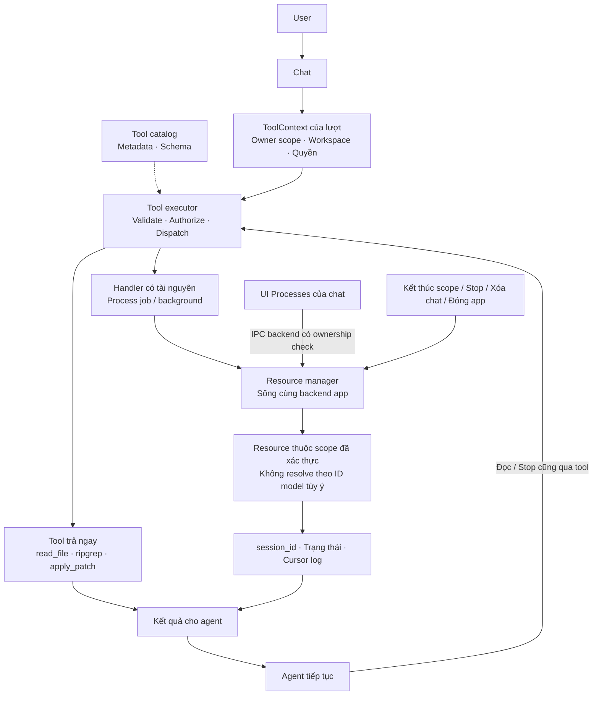
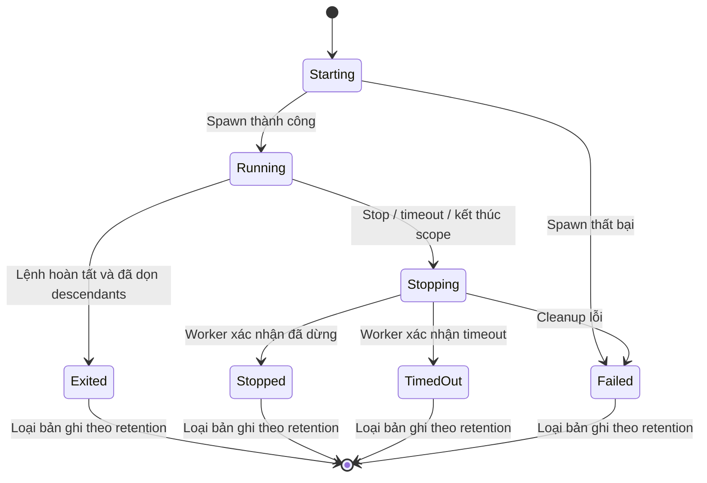

# Quản lý tool, process session và tài nguyên theo chat

- Ngày soạn: 2026-11-09.
- Trạng thái: **APPROVED — user yêu cầu triển khai ngày 2026-11-09; process scope desktop đã triển khai**.
- Vị trí sau khi được duyệt: `docs/architecture/tool-resource-lifecycle.md`.
- Nguồn: đối chiếu code Atlas và suy luận kiến trúc trong cuộc trao đổi với user.
  Chưa dùng một repo/bài viết bên ngoài để kiểm chứng toàn bộ thiết kế này.
- Phê duyệt: user nói “okay vậy tiến hành thực thi đi và bày cho mình cách để thấy nó hoạt động”.
- Phạm vi: background theo chat, UI Processes và demo; giữ vòng đời MCP hiện tại.

## 1. Bài toán và nền tảng đã có

Trước thay đổi này, desktop tạo runtime mới cho mỗi lượt. `ProcessSessions` thuộc runtime;
`exec_command` có thể trả `session_id`, agent gọi `read_process` lấy output mới
hoặc `stop_process` yêu cầu dừng. Request scope dọn mọi process khi lượt kết thúc.
Hành vi này đã được mô tả ở [Process sessions](process-sessions.md).

Muốn agent khởi động dev server rồi tiếp tục dùng ở tin nhắn sau thì chủ sở hữu
của server phải sống lâu hơn runtime một lượt. Đồng thời, chat khác không được
đọc nhầm log, dừng nhầm process hoặc dùng workspace/quyền của chat trước.

Thiết kế này giữ executor kiểm tra quyền hiện tại, thêm lớp quản lý tài nguyên
có vòng đời rõ ràng. Phạm vi triển khai đầu tiên đề xuất là process sessions.

## 2. Ba thành phần

| Thành phần | Trách nhiệm |
| --- | --- |
| Tool catalog | Metadata và schema của tool khả dụng; không khởi động process hay kết nối chỉ để nạp catalog. |
| Tool executor của lượt | Nhận ToolContext, kiểm tra tham số/quyền, thực thi handler và đưa kết quả về agent. |
| Resource manager trong backend app | Giữ resource còn sống: owner, trạng thái, output có giới hạn và cleanup. |

Không chuyển nguyên ToolRegistry đang mang workspace/settings của một lượt thành
singleton toàn app. Các runtime mới nhận một scope handle có giới hạn truy cập;
handler dùng handle đó để tìm resource. Provider/model không tự quản lý tiến trình.

## 3. Scope và quyền sở hữu

ToolContext dự kiến gồm owner scope, request ID, workspace đã được backend xác
thực và permission mode hiện hành. Scope ID/resource ID đều opaque; không dùng
PID làm quyền truy cập và không nhận owner chat từ arguments do model tự đặt.

- Backend chọn scope của conversation từ metadata và native session ownership.
  Saved conversation bỏ qua workspace/mode xung đột do frontend gửi lên.
- Chat nháp có scope tạm do backend cấp trong bộ nhớ; tạo chat không ghi history.
- Sau lần trả lời đầu tiên được lưu thành công, gắn scope nháp với conversation
  ID mà không đổi session ID của process đang chạy.
- Nếu lượt đầu thất bại, job được dọn; background được user yêu cầu rõ ràng vẫn
  thuộc chat nháp đang hiển thị, có thể Stop. Không tạo conversation chỉ để giữ nó.
- UI/model chỉ xem hoặc điều khiển resource của scope đã được backend resolve.
  Biết UUID chat/resource khác không thay được scope handle của request.
- Workspace của từng process được giữ tại lúc khởi động. Đổi workspace không
  chuyển cwd của process cũ; UI phải hiện cwd cũ để user không nhầm.
- Cấu hình/quyền khởi động không cấp quyền cho hành động mới. Các thao tác start,
  stop và remote call sau đó vẫn áp dụng policy hiện hành, không tái dùng approval cũ.

## 4. Phân loại vòng đời

| Loại | Ví dụ | Chủ sở hữu / thời điểm dọn |
| --- | --- | --- |
| Kết quả tức thời | Đọc file, tìm kiếm, patch | Request; không giữ process chỉ để quản lý kết quả. |
| Job | Build, test, script | Request; dọn khi hoàn tất, lỗi hoặc lượt bị kết thúc. |
| Background | Dev server, theo dõi liên tục | Chat scope; sống qua final answer khi user đã yêu cầu rõ ràng. |
| Metadata dùng chung | Catalog tool, config | App/workspace theo nguồn; mỗi lượt dùng snapshot phù hợp. |
| Kết nối MCP | Discovery/call | Giữ policy request/runtime hiện có; chưa đổi thành kết nối background. |
| Skills | Metadata và instruction | Giữ scope Personal/Project và snapshot của lượt như hiện tại. |

Background là lựa chọn tường minh, mặc định vẫn là job. Agent không tự biến lệnh
bất kỳ thành dịch vụ chạy lâu. Approval Command ở Ask/Workspace cần hiện vòng đời
và cwd; Full access giữ semantics bỏ qua xác nhận Atlas hiện tại. Lệnh phải chạy
foreground trong process group/Job được quản lý; không dùng `&` để giả lập background.

Không tự retry, replay hay restart process đã lỗi/timeout. Stop không rollback
những tác động đã xảy ra. Có session ID không đồng nghĩa với lệnh còn chạy hay
đã thành công; phải đọc trạng thái và exit/error.

## 5. Trạng thái và cleanup

Phân biệt `stop_requested` với cleanup đã hoàn tất. UI giữ Stopping khi worker
chưa xác nhận; không báo stopped chỉ vì gửi được yêu cầu. Worker tự cập nhật
trạng thái, không cần một lần gọi model để biết process đã kết thúc.

| Sự kiện | Job | Background đã được yêu cầu |
| --- | --- | --- |
| Final answer / lỗi model | Dọn | Tiếp tục, hiển thị trong chat |
| Chuyển chat / mở Settings | Giữ ownership, không chuyển sang chat khác | Tiếp tục |
| User Stop process | Dừng resource được chọn | Dừng resource được chọn |
| Hủy lượt trả lời | Dọn job của lượt | Không tự dừng resource có từ lượt trước |
| Xóa/đóng chat nháp hoặc xóa conversation | Dọn theo scope | Dọn theo scope |
| Reload webview | Dọn scope nháp bị mất owner | Saved chat có thể gắn lại scope trong backend còn sống |
| Đóng app bình thường | Dọn manager trên worker shutdown | Dọn manager trên worker shutdown |
| Restart app | Không khôi phục process hay ID cũ | Không tự chạy lại lệnh |

Shutdown không được join tiến trình trên Tauri event thread. Dọn có deadline,
trạng thái lỗi và thông tin còn chưa xác minh; không hứa cleanup trước mọi kiểu
OS crash/SIGKILL hoặc process chủ động thoát khỏi containment. Không cần mở rộng
frontend shell/filesystem/process permissions để làm cơ chế này.

## 6. Agent biết session nào, đọc log thế nào?

Catalog cung cấp snapshot metadata ngắn, ưu tiên các process còn chạy: session ID,
lifetime và trạng thái. Agent dùng danh sách đầy đủ để kiểm tra cwd khi cần. Không nạp raw log hay toàn bộ
command có thể chứa credentials. Snapshot được giới hạn và tính vào context budget;
không tăng vô hạn theo lịch sử chat.

Luồng mong muốn:

1. User yêu cầu chạy dev server qua nhiều lượt.
2. Agent gọi tool khởi động với vòng đời background; executor áp dụng policy.
3. Manager trả mã, trạng thái và output ban đầu; agent trả lời user.
4. Ở lượt sau, agent thấy metadata server vẫn chạy.
5. Agent gọi `read_process(session_id)` khi cần kiểm tra output, hoặc `stop_process`.

Tái dùng mã không chạy lại lệnh. Mã hết hạn/không thuộc scope phải trả lỗi rõ ràng,
không âm thầm tìm resource khác hay thực hiện lại command.

## 7. Log cho agent và UI: không tranh nhau tiêu thụ

API hiện tại tiêu thụ output sau mỗi lần đọc. Nếu UI và agent dùng chung cursor
này, UI có thể lấy mất output trước khi agent đọc. Vì vậy phase multi-turn cần:

- Một ring buffer có giới hạn cho mỗi stdout/stderr, với offset tăng tuyệt đối.
- Reader agent và reader UI có cursor riêng; đọc không xóa bytes khỏi buffer chung.
- `read_process` giữ hành vi mặc định lấy phần mới cho reader agent của scope;
  có thể thêm cursor tùy chọn để đọc lại phần vẫn còn trong buffer.
- UI đọc qua `atlas-api.ts`, dùng cursor của viewer, không gọi invoke rải rác.
- Kết quả trả next cursor, vị trí cũ nhất còn giữ và cờ mất dữ liệu. Cursor đã bị
  eviction phải báo gap/truncation; không giả vờ log đầy đủ.
- Khi hết byte UTF-8 ở giữa ký tự, đợi phần còn lại hoặc flush lossy khi kết thúc.
- Metadata/trạng thái có thể push bằng event; log chỉ fetch khi cần và giới hạn
  kích thước. Diagnostic backend không ghi command arguments hoặc raw output.

Đề xuất khởi điểm giữ giới hạn 8 process đang chạy mỗi chat, thêm 32 active toàn
app; giữ tối đa 32 record mỗi chat và 128 record toàn app, kể cả đang chạy. Buffer
64 KiB mỗi stream, giới hạn trả một lần 64 KiB/stream. Đây là giới hạn đề xuất,
chưa phải cấu hình/hành vi đã triển khai.

## 8. UI tối thiểu

Một disclosure **Processes** trong chat, không tạo hàng loạt nút trên composer.
Mỗi dòng: mã ngắn, job/background, trạng thái, cwd và Stop khi còn chạy. Mở dòng
để xem output/truncation/exit code. Không hiển thị process của chat khác; nút Stop
không vô tình hủy lượt hoặc approval của chat khác. Chưa thêm terminal tương tác.

Scope nháp phải tiếp tục nhìn thấy được nếu background còn sống sau lỗi; tránh
resource vô chủ trong backend. Backend chọn ownership, frontend chỉ trình bày và
đề nghị thao tác thông qua API typed.

## 9. Phạm vi triển khai và kiểm chứng

1. **Ownership:** public interface scope, manager trong DesktopState, runtime nhận
   scope handle. Giữ CLI request-local; CLI mới là process OS mới, chưa có daemon.
2. **Lifecycle:** tách job/background, transfer draft → saved ID, stop/xóa/shutdown
   và xử lý scope nháp mất owner. Không thay MCP/OAuth hay vòng đời skills.
3. **Log:** ring buffer có offset, reader riêng, xử lý gap và UTF-8, API metadata.
4. **UI/context:** Processes disclosure và snapshot metadata bounded đầu lượt.

Test bắt buộc: khác chat không đọc/dừng được nhau; đổi workspace/quyền không đổi
resource cũ hay vượt policy; final/error dọn job và giữ background đúng lựa chọn;
UI đọc log không làm agent mất log; cleanup descendants/stop races; orphan draft,
reload, delete và normal shutdown; overflow/cursor stale; không ghi history cho
chat nháp; không tự replay lệnh. Kiểm tra native Windows/macOS riêng, không suy
ra từ test browser hoặc compile.

## 10. Quy trình lưu tài liệu

Bản đã duyệt được đưa vào `docs/architecture/tool-resource-lifecycle.md`.
Draft gốc, plan, ledger, log và preview tiếp tục ở `.superpowers/` được Git bỏ qua.
Duyệt tài liệu/triển khai không tự cho phép push, merge hoặc deploy.

Xem [API hiện tại](process-sessions.md) và [demo từng bước](../guides/process-manager-demo.md).

## Quyết định triển khai

- Background mặc định 1 giờ, timeout tối đa 24 giờ; job giữ giới hạn 10 phút.
- UI Stop là thao tác user tường minh trên resource thuộc chat; tool Stop vẫn đi qua Command approval.
- Draft scope native cấp token theo window/client epoch; reload dọn draft scope cũ.
- Tiến trình không lưu xuống đĩa và không tự restart. Shutdown normal dọn trên worker có deadline.
