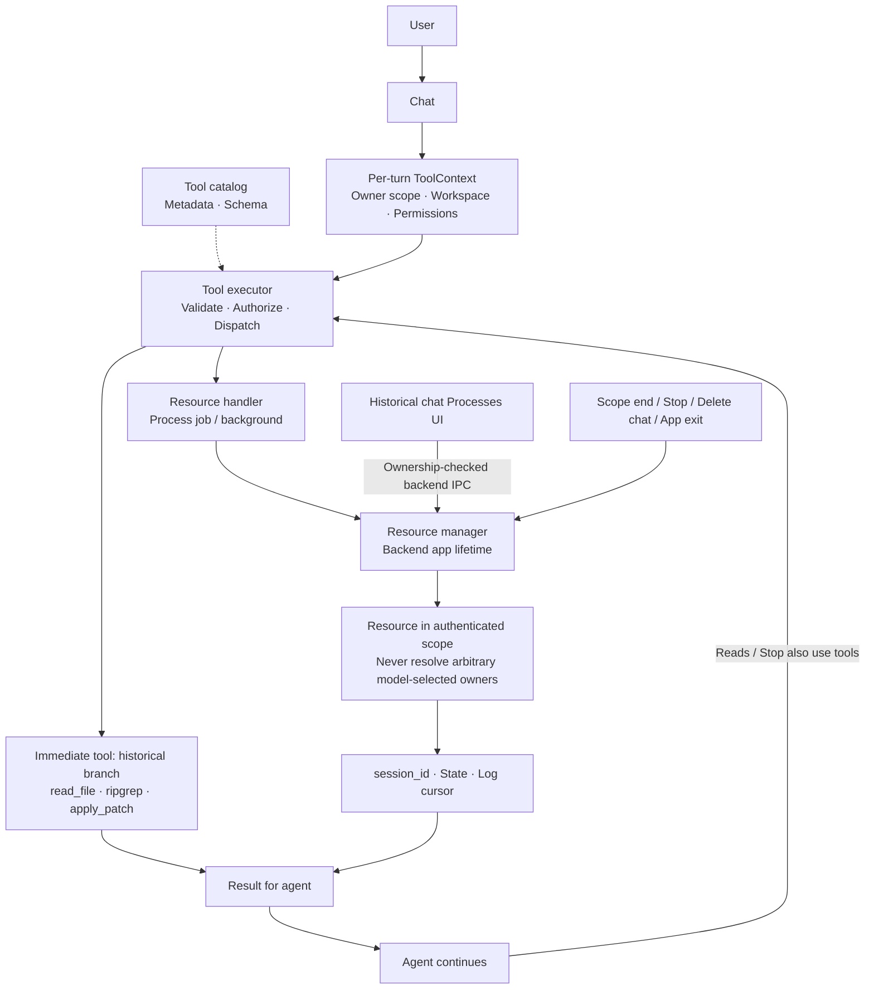
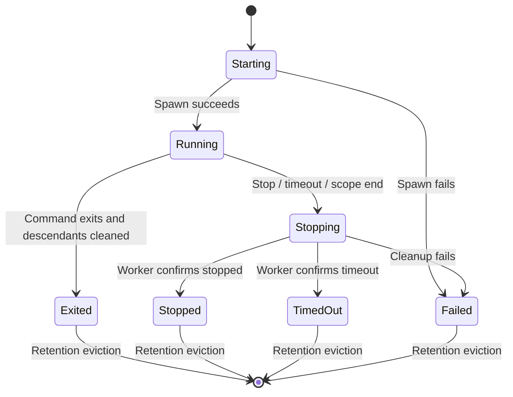

# Managing tools, process sessions, and chat-owned resources

> Architecture update, 2026-11-13: [Tool execution control and hard/lazy](tool-execution-control.md)
> routes every tool through one manager and stores bounded results. Implementation
> is implemented and verified; immediate-tool branches and lifecycle classifications below
> describe the earlier design/baseline. Command job/background lifetime remains
> distinct from removed execution job/task modes.

> UI update, 2026-11-10: at the user's request, the separate Processes disclosure
> was removed. Tool execution now appears inline as a terminal card with command,
> state, and output; raw details are collapsed and history is retained in Activity.
> Process management/native ownership are unchanged. Panel descriptions below
> record the approved design before this UI revision.

- Written: 2026-11-09.
- Status: **APPROVED — user requested implementation on 2026-11-09; desktop process scopes implemented**.
- Approved location: `docs/architecture/tool-resource-lifecycle.md`.
- Source: comparison with Atlas code and architectural reasoning in discussion
  with the user; no external repository/article was used to validate the whole design.
- Approval: the user said, “okay, proceed with implementation and show me how to see it working” (translated).
- Scope: per-chat background work, Processes UI, and demo; preserve existing MCP lifetime.

## 1. Problem and existing foundation

Before this change, desktop created a new runtime per turn. ProcessSessions belonged
to that runtime; `exec_command` could return `session_id`, `read_process` retrieved
new output, and `stop_process` requested termination. Request scope cleaned up all
processes at turn end, as described in [Process sessions](process-sessions.md).

To start a dev server and reuse it in a later message, its owner must outlive a
single-turn runtime. Other chats must never read its logs, stop its processes, or
inherit another chat's workspace/permissions.

This design preserves executor authorization and adds explicitly scoped resource
management. Process sessions are the proposed first implementation scope.

## 2. Three components

| Component | Responsibility |
| --- | --- |
| Tool catalog | Available tool metadata/schema; loading it never launches processes or connections |
| Per-turn tool executor | Receives ToolContext, validates arguments/permissions, dispatches handlers, and returns results |
| Backend app resource manager | Owns live resources, ownership, state, bounded output, and cleanup |

Do not make a whole ToolRegistry carrying one turn's workspace/settings into an
app singleton. New runtimes receive scoped access handles; handlers resolve
resources through those handles. Providers/models never manage processes themselves.

## 3. Scope and ownership

ToolContext carries owner scope, request ID, backend-validated workspace, and
current permission mode. Scope/resource IDs are opaque; PIDs never grant access,
and model arguments never select a chat owner.

- Backend derives conversation scope from metadata and native session ownership.
  Saved conversations ignore conflicting frontend workspace/mode values.
- Draft chats receive temporary in-memory backend scopes without creating history.
- After the first successfully saved answer, bind the draft scope to its
  conversation ID without changing running process session IDs.
- If the first turn fails, clean jobs; explicitly requested background work remains
  owned by the visible draft and stoppable. Do not create a conversation just to keep it.
- UI/model can inspect/control only resources in the backend-resolved scope.
  Knowing another chat/resource UUID cannot replace the request's scope handle.
- Preserve each process's launch workspace. Workspace changes do not move old cwd;
  show original cwd so the user can distinguish it.
- Launch configuration/approval never authorizes new actions. Later starts, stops,
  and remote calls use current policy rather than reusing previous approvals.

## 4. Lifetime classes

| Class | Examples | Owner / cleanup point |
| --- | --- | --- |
| Immediate result | Reads, searches, patches | Request; no process kept merely to manage results |
| Job | Build, test, script | Request; cleanup on completion, failure, or turn termination |
| Background | Dev server, continuous monitoring | Chat scope; survives final only on explicit user request |
| Shared metadata | Tool catalog, configuration | App/workspace according to source; appropriate snapshot per turn |
| MCP connection | Discovery/calls | Preserve current request/runtime policy; no background-connection migration |
| Skills | Metadata/instructions | Preserve Personal/Project scopes and request snapshots |

Background is explicit; job remains default. The agent cannot turn arbitrary
commands into long-running services. Ask/Workspace Command approvals show lifetime
and cwd; Full access retains existing Atlas-confirmation bypass semantics.
Commands run in foreground within managed process groups/Jobs; do not fake
background lifetime with `&`.

Never automatically retry, replay, or restart failed/timed-out processes. Stop
does not undo previous effects. A session ID does not prove running state or
success; inspect state and exit/error information.

## 5. State and cleanup

Distinguish `stop_requested` from confirmed cleanup. Keep Stopping until worker
confirmation; sending a request does not prove stopped state. Workers update state
without requiring a model call to discover process completion.

| Event | Job | Explicitly requested background |
| --- | --- | --- |
| Final answer / model error | Cleanup | Continue, visible in chat |
| Chat navigation / Settings | Preserve ownership; never transfer to another chat | Continue |
| User Stop process | Stop selected resource | Stop selected resource |
| Cancel answer | Cleanup turn's jobs | Do not automatically stop resources from earlier turns |
| Delete/close draft or delete conversation | Scope cleanup | Scope cleanup |
| Webview reload | Cleanup drafts losing their owner | Saved chats can reattach within the live backend |
| Normal app exit | Manager cleanup on shutdown worker | Manager cleanup on shutdown worker |
| App restart | No process/ID restoration | No automatic command replay |

Shutdown never joins processes on Tauri's event thread. Cleanup has deadlines,
error state, and explicitly unverified outcomes; do not guarantee cleanup for all
OS crashes/SIGKILLs or deliberate containment escape. No broader frontend
shell/filesystem/process permissions are needed.

## 6. Discovering sessions and reading logs

The catalog supplies a short bounded metadata snapshot prioritizing active
processes: session ID, lifetime, and state. The agent uses full listings to inspect
cwd when needed. Never preload raw logs or full commands that may contain secrets.
Snapshots count toward context budgets and never grow with unlimited chat history.

Expected flow:

1. User explicitly requests a dev server across turns.
2. Agent starts it with background lifetime; executor applies policy.
3. Manager returns ID, state, and initial output; agent answers the user.
4. On a later turn, the agent sees metadata indicating the server remains active.
5. Agent calls `read_process(session_id)` as needed or `stop_process` to stop it.

Reusing an ID never reruns a command. Expired/foreign IDs produce explicit errors,
never substitution with another resource or command replay.

## 7. Independent log readers for agent and UI

The original API consumed output on each read. Sharing that cursor between UI and
agent could hide output from the agent, so multi-turn support requires:

- A bounded ring per stdout/stderr with absolute increasing offsets.
- Separate agent/UI cursors; reads do not delete bytes from the shared buffer.
- `read_process` defaults to new output for the scope's agent reader and supports
  optional explicit cursors to reread retained bytes.
- UI reads through atlas-api.ts with its viewer cursor, without scattered invoke calls.
- Return next cursor, oldest retained position, and loss flags. Evicted cursors
  report gaps/truncation rather than pretending logs are complete.
- Preserve incomplete UTF-8 tails until complete or flush lossily on completion.
- Metadata/state may use events; logs are fetched only when needed and bounded.
  Backend diagnostics never record command arguments or raw output.

Initial proposed limits were 8 active processes/chat, 32/app, 32 retained
records/chat, 128/app, and 64 KiB per stream/read. These were design proposals at
drafting time; current configurable limits are documented in [Process sessions](process-sessions.md).

## 8. Historical minimal UI proposal

The original approved design proposed a **Processes** disclosure in chat rather
than many composer buttons. Rows showed short ID, job/background, state, cwd, and
Stop while running; expanding showed output/truncation/exit code. It excluded
foreign-chat resources and avoided cancelling another chat's turn/approval. No
interactive terminal was proposed. The UI update above supersedes this disclosure.

Draft scopes remain reachable when background work survives an error so resources
never become ownerless. Backend chooses ownership; frontend presents state and
requests operations through typed APIs.

## 9. Implementation scope and verification

1. **Ownership:** public scope interface, manager in DesktopState, runtime scope
   handles. Keep CLI request-local; a new CLI invocation is a new OS process, not a daemon.
2. **Lifecycle:** separate job/background, draft-to-saved binding, stop/delete/shutdown,
   and draft-owner loss. Do not change MCP/OAuth or skill lifetime.
3. **Logs:** offset rings, independent readers, gaps/UTF-8, metadata API.
4. **UI/context:** original Processes disclosure proposal and bounded startup metadata;
   current UI uses inline tool cards instead.

Required tests: cross-chat read/stop isolation; workspace/permission changes never
alter old resources or bypass policy; final/error cleans jobs and preserves only
explicit background work; UI reads cannot consume agent output; descendant cleanup
and stop races; orphan drafts, reload, deletion, normal shutdown; overflow/stale
cursors; no history merely for draft scopes; no automatic replay. Verify native
Windows/macOS separately rather than inferring acceptance from browser tests or compilation.

## 10. Documentation workflow

The approved version lives in `docs/architecture/tool-resource-lifecycle.md`.
Original drafts, plans, ledgers, logs, and previews stay in Git-ignored
`.superpowers/`. Document/implementation approval does not authorize push, merge,
or deployment.

See the [current API](process-sessions.md) and [walkthrough](../guides/process-manager-demo.md).

## Implementation decisions

- Background defaults to one hour, maximum 24 hours; jobs retain a ten-minute cap.
- UI Stop requires explicit user intent on an owned resource; tool Stop uses Command approval.
- Native draft tokens belong to window/client epochs; reload cleans old draft scopes.
- Processes are not persisted or automatically restarted. Normal shutdown cleans up on bounded workers.
