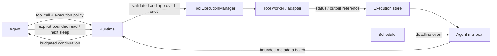

# Wakeup: scheduled tool execution

Status: approved on2026-11-13 and implemented; verification/demo commands below.

## Purpose

Tools execute once. Atlas owns their execution IDs and wakes the requesting agent
at its chosen deadline or on completion. The agent chooses which output to read,
how many lines to read, and how long to sleep next. Wakeups contain metadata only;
logs and results are never automatically replayed into model context.

## Ownership and structure

ToolExecutionManager lives with the backend and owns execution records, one mailbox
per agent, and one scheduler. CLI/runtime defaults create a private manager; desktop
injects its shared manager using a native chat scope. A child agent has its own
mailbox beneath the root chat scope. IDs are opaque capabilities resolved against
the native owner, never model-selected conversation IDs.

ProcessManager and AgentRunManager remain the authority for their resources.
Adapters connect them to execution records; the scheduler does not launch duplicate
processes, interpret shell syntax, approve tools, or make model calls.



Execution states: running, cancelling, succeeded, failed, cancelled. A requested
cancellation is not confirmation of cancellation. Nonzero command exit, timeout
and worker errors are distinguished from successful tool dispatch. Opaque external
actions can have unknown outcomes; never automatically retry them.

## Model protocol

Existing tool_call objects remain valid. An optional top-level policy is separate
from tool args and from process lifetime:

```json
{"type":"tool_call","tool":"exec_command","execution":{"mode":"job","yield_ms":2000},"args":{"command":"cargo test"}}
```

- job: wait for the first wakeup/completion before continuing the agent.
- task: return an execution ID immediately so the agent can do other work.
- Fast tools can finish immediately in either mode.
- Sleep intervals are 100–29999 milliseconds, strictly below30seconds. This is not
  a total execution timeout. Existing process, network and agent deadlines remain.

Concrete controls: `await_execution` takes execution_id or execution_ids and
yield_ms; `read_execution` takes execution_id with tail_lines or cursor;
`list_executions` discovers owned records; `cancel_execution` requests cancellation
under the existing runtime confirmation policy. These are top-level protocol types.

These execution_id values are distinct from process session_id, child run_id, and
built-in conversation task IDs such as conversation.compact. Do not interchange them.

The agent may subsequently wait for one or more owned executions, read a bounded
result, or request cancellation. Each new wait can change the interval. The
protocol is runtime-controlled and provider-independent; it grants no extra tools
or permissions. Worker preparation moves the exact approved context, including
patch preimages, to a worker copy. No stale approval is reconstructed or bypassed.

## Mailbox and scheduler

A short mutex protects records, pending notifications, in-flight delivery and the
sleep predicate. Never hold it during I/O, worker joins, authorization or a model
call. Each owner has one active consumer; independent agents can run concurrently.

Pending notifications coalesce by execution ID and monotonic revision. Terminal
states replace periodic running notices and are queued once. New events arriving
while a batch is in flight remain pending; acknowledgement affects only that
batch. Invalid model replies and provider errors do not acknowledge it. Tool
execution is never replayed to recover a delivery.

A bounded batch contains at most16 metadata events and no output text:

```json
{"type":"execution_wakeup","batch_id":"opaque","events":[{"execution_id":"opaque","reason":"completed","status":"succeeded","unread_lines":12}],"pending_count":0}
```

Completion/error/input-needed notices precede periodic notices; ordering within a
priority is FIFO. No blanket invalidation of a model decision because an unrelated
execution changed. Before sleeping or finalizing, inspect pending notifications
under the same lock. Waiting atomically releases the lock through Condvar and
rechecks the predicate in a loop, preventing lost wakeups and handling spurious
notifications. Never run two model calls simultaneously for one owner.

One scheduler sleeps until the nearest deadline, with a versioned deadline heap.
Changing a schedule invalidates old entries. Compact stale heap entries under a
bounded threshold. Completion cancels its timer. When an agent is active, new
metadata is delivered at the next model boundary; a timer never calls a provider
or interrupts a partially streamed answer. A final response releases the consumer:
there is no hidden model invocation after final or app restart. Retained tasks can
be inspected in the next authorized request in the same native scope.

## Output

Wakeups contain status, elapsed time and output availability, not log text. Reading
is explicit: tail_lines1–200 or an absolute byte cursor; no read-all option.
Default explicit reads return at most20 lines, and every read has a hard4096-byte
UTF-8 content cap, even for one enormous line. Tail reads do not consume a delta
cursor. Returned source offsets, next cursor, retention loss, partial line and
truncation flags explain omissions. A structured result is identified as complete
JSON only when the selected bytes contain the entire result. Otherwise it is a
labelled partial text view, never silently parsed as a complete result.

Retain at most64KiB output per execution,32 records/owner128/backend and8 active/
owner32/backend. These are execution limits, not total OS process/CPU/RAM quotas.
Admission precedes launch. Do not evict active records or undelivered terminal
notifications; reject new work if safe retention cannot admit it. Reject foreign
IDs and late publications into closed scopes. Worker error details use the same bounded output store and line selection, not an
unbounded error field. Image results are available only to the original active
consumer generation; finishing a request clears images, and closing an owner
discards existing/late output and image payloads.

No credentials/raw output in
backend logs, ordinary chat history or wakeup events. Images remain ephemeral and
are not converted to persistent text blobs.

## Shutdown and compatibility

Closing a chat cancels owned executions and descendants; existing process groups
and Windows Jobs still perform native cleanup. Shutdown stops scheduling and
waits for owned work on a bounded deadline. Uninterruptible tools may remain
cancelling until their existing I/O deadline; do not claim success or rerun them.
Failed/abandoned jobs request cooperative cancellation before request cleanup;
tasks retain their declared lifetime. Child execution scopes link to RunControl
cancel/deadline and close when the child exits, so abandoned child workers do not
outlive their owner. No execution restoration after app restart. MCP gateways can use Atlas Wakeup for
their existing calls; this does not advertise unsupported remote MCP Tasks versions
or extend server timeouts. CLI and desktop share the protocol and prompts. UI uses
the existing inline tool/agent cards and Activity, with no new permanent toolbar.

## Verification

Tests must cover adjustable waits, completion before deadline, metadata-only events,
line/byte caps and UTF-8, concurrent owners, coalescing and ack, terminal delivery,
stale timers, full-mailbox admission, failed model calls, no replay, destructive
approval snapshots, cancellation, and successful-turn activity/context budgeting.


## Demo and source map

Run `cargo run --example wakeup` without a provider/API key. It uses an in-memory
ticker and deterministic fake model, showing metadata-only notifications, reads of
three lines, a change from500ms to1000ms sleep, and completion before that deadline.
It does not write project files or execute external commands.

Core: src/executions/{mod,output,protocol,worker}.rs. Runtime adapter:
src/runtime/wakeup.rs and src/runtime.rs. Shared instructions:
config/wakeup-prompt.md. Native ownership: desktop/src-tauri/src/process_commands.rs.
Regression coverage: tests/wakeup_behavior.rs and agent_runs lifetime tests.
