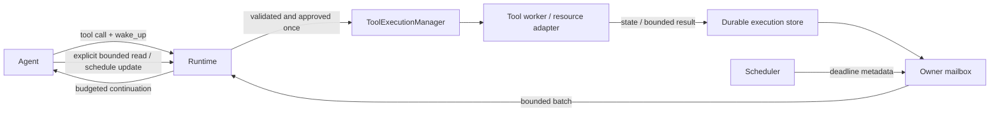

# Wakeup: managed tool execution

Status: hard/lazy tool execution implemented and verified on 2026-11-13. See [Tool execution control](tool-execution-control.md) for the approved
architecture and acceptance criteria. Desktop user input during an active turn
is covered by [Live chat input and Stop](live-chat-input.md).

## Purpose and ownership

Every tool executes once under an owned execution ID, including tools that finish
immediately. Production default tools use managed workers; synchronous custom-tool
fallbacks are also tracked. Atlas wakes the requesting agent at the chosen cadence
or on completion. Wakeups contain metadata only; the agent explicitly selects
bounded result/log reads. Notifications never replay tool execution.

ToolExecutionManager lives with the backend and owns records, one mailbox per
agent, and one scheduler. CLI/runtime defaults use private managers; desktop
injects its shared manager using native chat scopes. Child agents have their own
mailboxes under root chat ownership. IDs resolve against native owners; model
arguments never choose conversation owners.

ProcessManager and AgentRunManager retain authority over their respective
resources. Adapters normalize process and child-run results into execution state.
The scheduler neither launches duplicate processes nor interprets shell syntax,
approves tools, or invokes providers.



States include running, cancelling, succeeded, failed, cancelled, and restart
recovery's interrupted. `publishing` and `storage_error` describe an execution
whose action result is awaiting durable publication; they are not successful
terminal states. A recovered write retries publication, never the tool action.
Cancellation requests are not confirmation. Command
nonzero exit, timeout, and worker errors remain distinct from successful dispatch.
External actions may have unknown outcomes; never automatically retry them.

## Model protocol

`wake_up` is optional and top-level, separate from args and command lifetime:

```json
{"type":"tool_call","tool":"exec_command","wake_up":{"mode":"hard","interval_seconds":2},"args":{"command":"cargo test"}}
```

```json
{"type":"tool_call","tool":"mcp_call_tool","wake_up":{"mode":"lazy"},"args":{"server":"configured-server","tool":"configured-tool","arguments":{}}}
```

The MCP example illustrates only the envelope; actual names come from the
permitted catalog. Hard requires finite `interval_seconds` at least 0.1 and
strictly below 30. Lazy forbids custom intervals and uses 600 seconds. Both queue
completion/error/interaction-needed notifications immediately. Omitted wake_up
defaults to hard every two seconds. Scheduler defaults and rendered instructions
share [config/execution-defaults.toml](../../config/execution-defaults.toml).
Wakeup cadence does not change permissions, tool timeouts, dependency order, or
work lifetime.

Controls are top-level protocol types:

The same controls also accept the ordinary `tool_call` envelope. For example:

```json
{"type":"tool_call","tool":"read_execution","args":{"execution_id":"opaque-id","tail_lines":20}}
```

The parser normalizes this into the same runtime operation as the dedicated
`read_execution` type. The five control names are reserved: they never look up
an ordinary tool or start another execution. Wrapped args reject unknown fields;
scope ownership, read limits, and cancellation authorization are unchanged.
Use `args.wake_up` only for `set_execution_wakeup`; controls reject top-level
`wake_up` because they do not launch workers.

```json
{"type":"set_execution_wakeup","execution_id":"opaque-id","wake_up":{"mode":"hard","interval_seconds":5}}
```

```json
{"type":"await_execution","execution_id":"opaque-id"}
```

```json
{"type":"read_execution","execution_id":"opaque-id","tail_lines":20}
```

`set_execution_wakeup` replaces the schedule without repeating the tool or losing
terminal notifications. `await_execution` accepts one execution_id or 1–32
execution_ids; it yields the consumer until a scheduled or terminal event and
never changes policy. The legacy yield_ms field is validated but does not create
an early notification deadline. Internal waiting continues without provider polling when no notification
is deliverable, including during lazy waits, and observes cancellation.
`read_execution` accepts tail_lines 1–200 or an absolute byte cursor, exclusively.
`list_executions` returns owned metadata; `cancel_execution` requests cancellation
under existing runtime confirmation rules.

Execution IDs differ from process session_id, child run_id, and built-in
conversation task IDs. Command `lifetime: job/background` and `call_agent`'s
`execution_mode: wait/parallel` retain their own meanings. Parent final answers
cannot bypass the guard while their own call_agent execution remains active.

Migration: old `execution: {"mode":"job"|"task", ...}` envelopes are rejected
with an explicit migration error. Use top-level wake_up; there is no automatic
mapping of task to lazy. Conversation tasks and MCP Tasks are separate concepts.

## Scheduler and mailbox

Short mutex sections protect state, pending/in-flight notifications, and the sleep
predicate; no state lock spans I/O, worker joins, approval, or model calls. Each
owner has one active consumer; independent owners may run concurrently.

Notifications coalesce by execution ID and monotonic revision. Terminal replaces
periodic running notices and is logically queued once. Events arriving during an
in-flight batch remain pending; acknowledgement applies only to that batch.
Provider errors/invalid responses do not acknowledge it, and recovery never
replays tools. Unacknowledged terminal delivery may repeat with the same identity.

A batch contains at most 16 metadata events without log text:

```json
{"type":"execution_wakeup","batch_id":"opaque","events":[{"execution_id":"opaque","reason":"completed","status":"succeeded","unread_lines":12}],"pending_count":0}
```

Completion/error/interaction notices precede periodic notices, FIFO within
priority. One versioned deadline heap handles execution schedules and ignores
stale timers after updates. Completion cancels periodic scheduling. New events
reach a busy agent at the next safe model boundary, never inside a streaming
response or through a concurrent call for that owner. Condvar waits atomically
release the short lock and recheck predicates, avoiding lost/spurious wakeups.

Final is blocked while required executions are running/cancelling or terminal
notifications remain unhandled, equally for hard and lazy. Notification delivery
alone does not establish correctness: read enough evidence to support conclusions.
Failure/cancellation can end in an honest report of incomplete work without
forcing retries. Explicit background services use their separate lifetime policy;
process startup must be inspected before reporting them running. Final ends the
consumer: no hidden provider calls after final or restart. Retain background
events for a later authorized turn rather than waking an agent across turns.

## Output and persistence

Wakeups contain status, elapsed time, unread-line availability, revisions, and
retention/truncation flags. Reads default to at most 20 lines and always cap UTF-8
content at 4096 bytes, even for a huge single line. Tail does not advance cursors.
Source offsets, next cursor, loss/partial-line flags, and truncation describe
omissions. Identify structured JSON as complete only when the entire result is
selected; otherwise return a labeled partial text view.

Retain at most 64 KiB output/execution, 32 records/owner, 128/backend, and 8 active/
owner, 32/backend. Execution limits are distinct from OS-process quotas. Admission
precedes launch and does not evict active records or undelivered terminal events;
reject work if safe retention cannot admit it. Foreign IDs and late publication
into closed owners are rejected. Worker errors use bounded output rather than
unbounded error fields. Images remain ephemeral for the original active consumer
generation and are cleared on request completion/owner closure, including late images.

Durable metadata/results live under `ATLAS_DATA_DIR/tool-executions` (or the normal
Atlas data root). Each manager has a UUID journal and holds its lifetime lease.
Cross-process import/publication uses a bounded 500 ms `import.lock`; live managers
are skipped. Inactive nonterminal records recover as interrupted, without restoring
handles or replaying actions. Saved chats use stable native owner aliases, including
descendant prefixes; draft promotion preserves identities. Checked chat deletion
moves owned records into `tool-executions/trash` and rejects late publication.

The defaults file sets `persistence_max_records = 128` and
`persistence_max_bytes = 12582912` (12 MiB). Journal and trash collections each
have these bounds independently; they are shared storage limits rather than an
unlimited quota per manager. Valid storage options are 1–128 records and
4096–67108864 bytes. Private, versioned, atomic snapshots contain bounded text and
metadata, never handles, credentials, approval tokens, or image payloads. Persist
before dispatch and preserve recoverable storage failures instead of claiming
success or replaying work. Committed results remain readable after restart;
reading an artifact does not authorize control of old handles.

Ordinary successful chat history keeps the original user request, applied
supplemental user messages, and final assistant answer. Explicit user Stop retains
a marked partial answer; see [Live chat input and Stop](live-chat-input.md). Activity stores
bounded references/summaries, not every wakeup or all logs. Execution results also
cover failed turns absent from successful history. Backend diagnostics contain
neither credentials nor raw output.

## Shutdown and compatibility

Closing a chat cancels owned executions/descendants, preserving process-group and
Windows Job cleanup. Shutdown stops scheduling and waits on bounded deadlines.
Uninterruptible tools may remain cancelling until their I/O deadline; never claim
confirmed cancellation early. Request cleanup preserves explicit command lifetime
semantics. Child execution scopes follow run cancellation/deadlines and close on
child exit. No process or agent handle is restored after restart. Atlas Wakeup
for MCP calls does not advertise remote MCP Tasks or extend server timeouts.
CLI/desktop share protocol and prompts. UI remains inline with Activity, without
a permanent Processes toolbar or automatic frontend output polling.

## Verification and source map

Verification covers interval bounds,
completion before deadline, lazy fake-clock scheduling, metadata-only batching,
line/byte/UTF-8 limits, concurrent ownership, coalescing/ack, stale timers, admission,
provider errors/no replay, exact approval snapshots, final guards, lazy-wait
cancellation, durable failures/restart/quotas, draft promotion/deletion, and child
scope cleanup. See the verification commands below.

Run `cargo run --example wakeup` for a deterministic fake-model/in-memory ticker
demo without provider credentials. It reads three-line samples, changes cadence,
and demonstrates early completion; it does not execute external commands or write
project files.

- Core: `src/executions/{mod,output,protocol,worker,persistence}.rs`.
- Runtime: `src/runtime/wakeup.rs` and `src/runtime.rs`.
- Defaults/instructions: `config/execution-defaults.toml`, `config/wakeup-prompt.md`.
- Native ownership: `desktop/src-tauri/src/process_commands.rs`.
- Tests: `tests/execution_protocol.rs`, `tests/execution_manager_control.rs`,
  `tests/wakeup_behavior.rs`, and delegated-agent lifetime tests.

## Await compatibility

`await_execution` waits for the selected executions' existing hard/lazy schedules
or terminal/interaction events. Its legacy `yield_ms` field is accepted and
validated in the 100–29999 ms range but never schedules an early model wakeup.
Use `set_execution_wakeup` to change cadence. In particular, `lazy` plus
`await_execution` with `yield_ms:100` still waits for the 10-minute reminder or an
earlier completion/error; it does not poll the model every 100 ms.

## Retired child scopes and recovered evidence

Retiring a child scope abandons its private pending notifications for retention,
without changing the recorded action outcome. The parent's managed `call_agent`
execution still reports the child's lifecycle and prevents an early final answer.
Frozen child results remain durable until bounded retention or chat deletion.
After restart, recovered descendant results appear as read-only archived evidence
to the owning root chat; unfinished results generate interrupted notifications
there. They cannot be cancelled, rescheduled, or used to restore live child handles.
Live children keep their separate mailboxes and native ownership.

A periodic reminder from an unrelated, explicitly authorized background execution
does not invalidate an otherwise completed answer. Leave that unhandled batch
available for the next authorized turn. Required executions and terminal or
interaction-needed events still participate in the final guard. Initial hard
waits, explicit awaits, and final waits all use the same scheduler deadlines;
there is no second timeout producing duplicate periodic model continuations.

## Verified commands

Verified on Linux on 2026-11-13: 615 Rust tests, 74 native tests, and 336 frontend
tests, plus formatting, root/native Clippy, frontend/native builds and the no-key
demo. Windows/macOS execution was not validated in this change.

```bash
cargo fmt --check
cargo test
cargo clippy --all-targets -- -D warnings
cargo test --manifest-path desktop/src-tauri/Cargo.toml --lib
cargo clippy --manifest-path desktop/src-tauri/Cargo.toml --all-targets -- -D warnings
cargo build --manifest-path desktop/src-tauri/Cargo.toml
cargo run --example wakeup
```

Run `npm test` and `npm run build` from `desktop/` for frontend verification.
